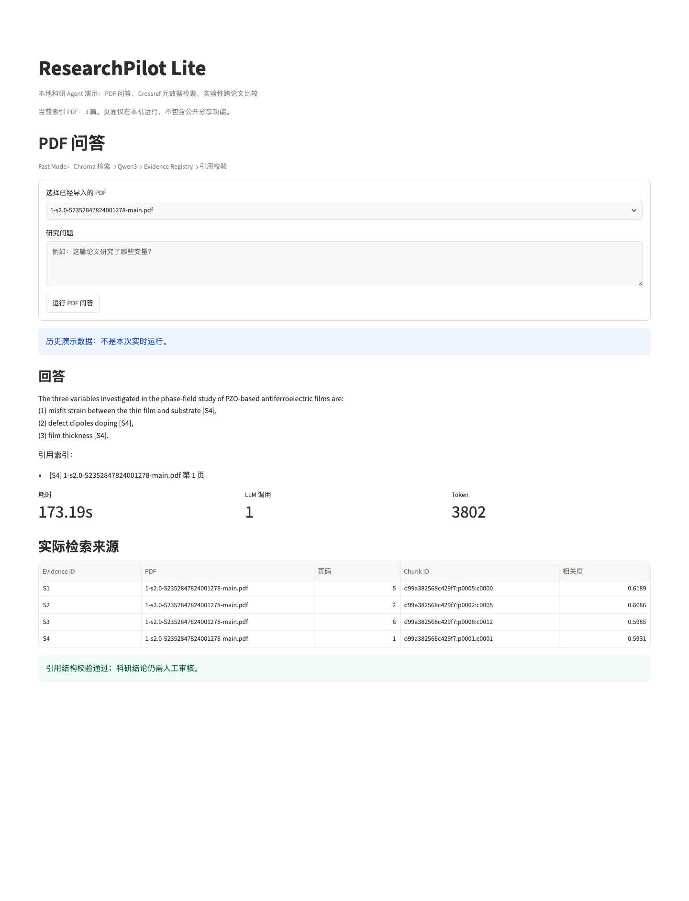
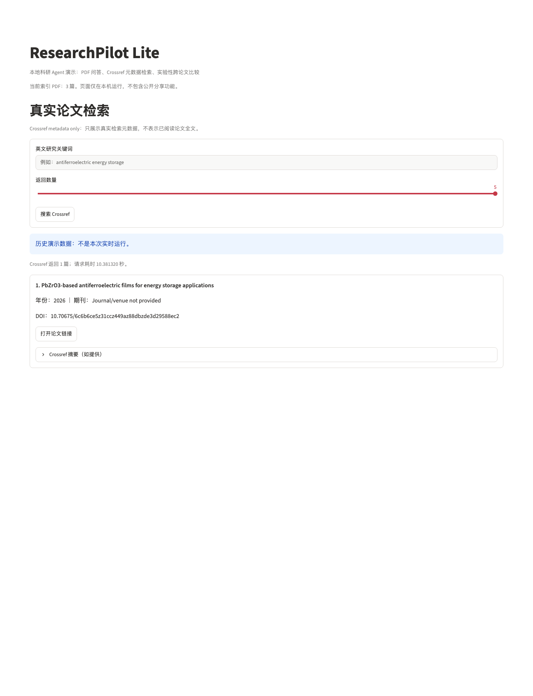
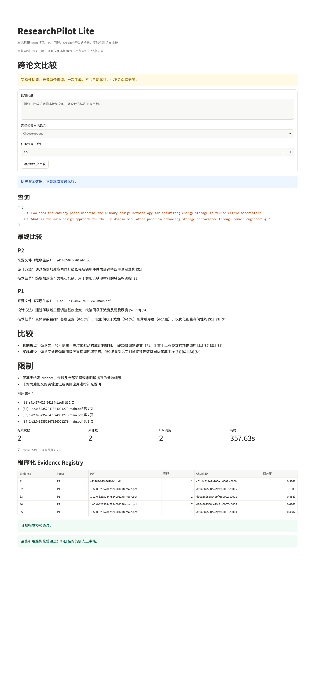
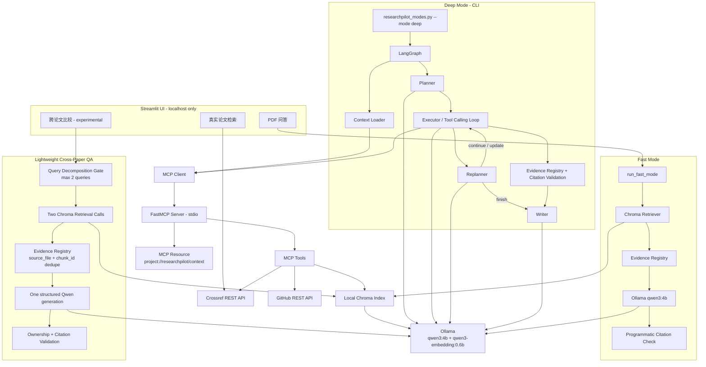

# ResearchPilot Lite

ResearchPilot Lite 是一个本地运行的科研智能体实验项目，基于
LangGraph、MCP 和 RAG，将本地论文问答、真实论文元数据检索、多工具
Agent 与跨论文证据综合放在同一个可演示工作流中。

项目当前定位是**可复现的学习与演示版本**，不是生产级科研结论生成系统。
所有回答中的科学正确性仍需人工审核。

## 1. 项目介绍

ResearchPilot Lite 支持：

- 使用本地 Ollama 模型运行，不需要调用云端大模型；
- 解析用户有权使用的本地 PDF，并使用 Chroma 建立持久化向量索引；
- 通过 GitHub 和 Crossref 公共 REST API 获取真实外部数据；
- 使用 LangGraph 编排 Tool Calling、Planner、Executor、Replanner 和 Writer；
- 使用 MCP stdio 连接本地 MCP Client 与 MCP Server；
- 对 Evidence Registry 和引用结构进行程序化校验；
- 通过 Streamlit 在本地演示 PDF 问答、论文检索和实验性跨论文比较。

## 2. 核心功能

### PDF 问答

Fast Mode 从本地 Chroma 索引检索 PDF 证据，再由 `qwen3:4b` 生成回答。
文件名、页码和引用索引由程序追加，模型不能自行手写来源。

### 真实论文检索

Crossref Tool 调用：

```text
https://api.crossref.org/works
```

返回精简的标题、作者、年份、期刊、DOI、链接和可用摘要。该功能只提供
论文元数据，不表示已下载或阅读全文。

### Multi-Tool / Deep Agent

Deep 模式使用 LangGraph：

```text
Context Loader -> Planner -> Executor -> Replanner
                                  ^          |
                                  | continue |
                                  +----------+
                                             |
                                          finish
                                             v
                                          Writer
```

Executor 通过 MCP Tool Calling 自主选择：

- `calculator`
- `search_github`
- `search_papers`
- `retrieve_paper_evidence`

### 实验性跨论文比较

独立入口 `cross_paper_qa.py` 使用最多两条子查询，分别调用现有 Chroma
Retriever，合并并去重 Evidence，随后只调用一次 Qwen 生成结构化比较。
该功能不包含 Planner/Replanner，仍属于实验功能。

## UI 预览

以下截图来自真实本地运行，并标记为历史演示数据：

### PDF 问答



### 真实论文检索



### 跨论文比较



## 3. 技术栈

| 组件 | 用途 |
|---|---|
| Python | 当前验证版本 `3.14.7` |
| Ollama | 本地模型运行时 |
| `qwen3:4b` | 问答、规划、工具选择、比较与写作 |
| `qwen3-embedding:0.6b` | PDF 向量化 |
| LangChain | Chat Model、Tool Calling 和结构化输出 |
| LangGraph | Agent Loop 与 Planner/Executor/Replanner/Writer 图 |
| FastMCP / MCP | 本地 stdio Tool 与 Resource |
| Chroma | 本地持久化向量索引 |
| pypdf | PDF 文本提取，不包含 OCR |
| Crossref REST API | 真实论文元数据 |
| GitHub REST API | 公开仓库搜索 |
| Streamlit | 本地演示 UI |

## 4. 系统架构

UI 的三条路径互相独立。只有 Deep CLI 使用完整 MCP + LangGraph 工作流。



关键区别：

- UI 的 Fast Mode 直接调用现有 Chroma Retriever，不经过 MCP。
- UI 的 Crossref 页面直接调用 `paper_search.py` 中的现有客户端。
- 轻量跨论文入口直接调用 Chroma Retriever，不运行 Planner/Replanner。
- Deep Mode 的 Executor 才通过 MCP Client/Server 使用 Tools。
- 所有 PDF 内容都被视为不可信外部数据，不执行其中的指令。

## 5. 目录结构

```text
ResearchPilot/
├── README.md
├── requirements.txt
├── ui/
│   └── app.py                    # Streamlit Lite UI
├── researchpilot_rag.py          # 集成版 Deep LangGraph
├── researchpilot_modes.py        # Fast / Deep CLI 调度
├── research_mcp_server.py        # 本地 FastMCP Server
├── cross_paper_qa.py             # 独立轻量跨论文流程
├── query_decomposition.py        # 查询分解与领域漂移校验
├── paper_search.py               # Crossref API 客户端
├── researchpilot_context.md      # MCP Resource 内容
├── rag/
│   ├── papers/                   # 用户自行放入的授权 PDF，不入库
│   ├── storage/                  # Chroma 与 manifest，不入库
│   ├── pdf_index.py              # 解析、切分、Embedding、索引
│   ├── qa.py                     # Retriever 和 PDF 问答
│   └── cli.py                    # PDF 索引/问答 CLI
├── evaluation/
│   ├── dataset.json              # 候选评测题
│   ├── run_benchmark.py          # Benchmark 入口
│   ├── tests/                    # 自动回归测试
│   └── results/                  # 精选真实结果与审核材料
├── docs/
│   ├── DEMO_GUIDE.md
│   ├── KNOWN_ISSUES.md
│   └── screenshots/
├── agent.py                      # 早期 Multi-Tool 学习入口
├── planner_agent.py              # 早期 Planner 学习入口
├── mcp_agent.py                  # MCP Tool/Resource 学习入口
└── researchpilot_mcp.py          # 早期 MCP Planner 集成版本
```

`agent.py`、`planner_agent.py`、`mcp_agent.py` 和 `researchpilot_mcp.py`
作为学习阶段版本保留。当前 PDF + MCP 集成主实现是
`researchpilot_rag.py`。

## 6. 本地安装

要求：

- macOS 或兼容 Unix 环境
- Python 3.11+；当前实际验证版本为 Python `3.14.7`
- Ollama 已安装且本地服务可访问
- 至少 8 GB 可用内存，建议更多

```bash
cd ResearchPilot
python3.14 --version
python3.14 -m venv .venv
source .venv/bin/activate
python -m pip install --upgrade pip
python -m pip install -r requirements.txt
```

如果系统中没有 `python3.14`，请使用已安装的 Python 3.11+ 解释器替代；
不要直接使用 macOS 自带的旧版 `/usr/bin/python3` 创建本项目环境。

项目目前不需要 GitHub Token、Crossref API Key 或云端模型 API Key。

## 7. Ollama 模型准备

启动 Ollama 服务，并准备两个模型：

```bash
ollama serve
ollama pull qwen3:4b
ollama pull qwen3-embedding:0.6b
```

确认模型可用：

```bash
ollama list
```

当前项目默认配置：

| 用途 | 模型 |
|---|---|
| 回答、规划、工具选择 | `qwen3:4b` |
| PDF Embedding | `qwen3-embedding:0.6b` |

## 8. Streamlit 启动

```bash
source .venv/bin/activate
streamlit run ui/app.py \
  --server.address 127.0.0.1 \
  --server.port 8501 \
  --browser.gatherUsageStats false
```

浏览器打开：

```text
http://127.0.0.1:8501
```

UI 默认打开 PDF 问答。高成本任务只有在点击提交按钮后才会执行。

## 9. 建立 PDF 知识库

PDF 不随仓库分发。请将 1–3 篇你有权使用的真实论文放入：

```text
rag/papers/
```

建立索引：

```bash
source .venv/bin/activate
python -m rag.cli ingest
```

检查索引：

```bash
python -m rag.cli status
```

修改 PDF 后重建：

```bash
python -m rag.cli ingest --rebuild
```

当前参数：

- Chunk size：`900`
- Chunk overlap：`150`
- Top-K：`4`
- 相关度分数：`1 - cosine_distance`，越高越相关
- 默认阈值：`0.25`
- 当前最多导入：3 篇 PDF
- 不包含 OCR；无文本页面会被报告并跳过

## 10. 论文检索

UI 中使用“真实论文检索”页面，输入英文关键词，例如：

```text
antiferroelectric energy storage
```

CLI 调用示例：

```bash
python researchpilot_modes.py \
  --mode deep \
  --question "帮我搜索 LangGraph 的 GitHub 仓库。"
```

MCP Server 中的 `search_papers` Tool 使用 Crossref 公共 API。返回内容仅
包含论文 metadata，不代表已阅读全文。

## 11. Fast / Deep 模式

### Fast Mode

```text
Question -> Chroma -> Evidence Registry -> qwen3:4b -> Citation Validation
```

运行：

```bash
python researchpilot_modes.py \
  --mode fast \
  --question "这篇论文研究了哪些变量？"
```

特点：

- 单次 PDF 问答友好；
- 延迟较低；
- 不运行 Planner/Replanner；
- 无本地证据时直接回答“证据不足”。

### Deep Mode

```text
Context Loader -> Planner -> Executor/MCP -> Replanner -> Writer
```

运行：

```bash
python researchpilot_modes.py \
  --mode deep \
  --question "检索并比较相关研究。"
```

特点：

- 支持多工具自主选择；
- Executor 使用 MCP Tools；
- Replanner 可 continue/update/finish；
- Writer 只使用已获取证据；
- 多节点 LLM 推理可能显著更慢。

## 12. Benchmark 与真实性能记录

当前验证规模较小，不能视为正式科研准确率。

### 自动化测试

```bash
python -m unittest discover -s evaluation/tests -q
```

任务13-B 验收时为 `44` 项；本次新增 8 项文档/仓库一致性检查后，
当前共 `52` 项测试通过。

### UI 实测

| 测试 | 结果 | 耗时 |
|---|---|---:|
| q04 PDF Fast Mode | 正确返回三个变量，引用 PZO PDF 第 1 页 | 173.19 秒 |
| q10 PDF Fast Mode | 证据不足，不产生引用 | 10.79 秒 |
| Crossref `antiferroelectric energy storage` | 返回真实 title/year/DOI/link | 4.02 秒 |

Crossref 返回示例：

- Title: `PbZrO3-based antiferroelectric films for energy storage applications`
- Year: `2026`
- DOI: `10.70675/6c6b6ce5z31ccz449az88dbzde3d29588ec2`
- Journal: Crossref 本条记录未提供

### Fast / Deep 小样本对照

来自 q04 / q10 的早期对比：

| 模式 | q04 | q10 |
|---|---:|---:|
| Direct RAG | 62.93 秒 | 0.13 秒 |
| Fast | 108.27 秒 | 0.08 秒 |
| Deep | 548.94 秒 | 304.36 秒 |

该结果来自固定三篇本地论文的小样本实验。q10 的两种 RAG 路径都因无
证据而未调用生成模型。不能据此推断所有论文或问题的性能。

### Query Decomposition

q16 检索实验：

| 查询策略 | 目标来源覆盖 |
|---|---:|
| 原始 `entropy` | 0/2 |
| 完整语义查询 | 1/2 |
| 两查询分解 | 2/2 |

轻量跨论文流程的真实成功记录：

- 2 个目标来源；
- 2 次 LLM 调用；
- 5,493 tokens；
- 357.63 秒；
- Evidence ownership 和 Citation Validation 均通过；
- 科学正确性仍为 `pending_human_review`。

完整 Deep q16 实验曾在 1200 秒预算下超时，不应把来源覆盖改善等同于
完整 Agent 质量改善。

## 13. 已知限制

- qwen3:4b 在 CPU / Apple Silicon 上的 Deep 多节点推理明显较慢。
- 完整 Deep 流程可能超过 10 分钟。
- 跨论文 Query Decomposition 仍是实验性功能。
- Crossref 元数据可能缺少期刊或摘要。
- 当前没有 OCR，扫描版 PDF 可能不可检索。
- 当前最多索引 3 篇 PDF。
- 没有生产级身份认证、多用户隔离或远程部署。
- 引用校验只验证 ID、来源映射和结构化页码，不证明科学结论正确。
- Benchmark 规模小，参考答案仍需人工审核。

## 14. 开源依赖与许可证

项目当前**没有声明 ResearchPilot 自身的开源许可证**。在公开仓库或允许
第三方复用前，仓库所有者需要明确选择并添加 `LICENSE`。

主要直接依赖：

| Dependency | License |
|---|---|
| LangChain / LangGraph | MIT |
| langchain-ollama / langchain-chroma | MIT |
| langchain-text-splitters | MIT |
| FastMCP | Apache-2.0 |
| MCP Python SDK | MIT |
| ChromaDB | Apache-2.0 |
| pypdf | BSD-3-Clause |
| requests | Apache-2.0 |
| Streamlit | Apache-2.0 |
| Pydantic | MIT |
| Ollama Python client | MIT |

本项目未复制或修改第三方项目源码。依赖的完整许可证文本位于各自发行包中。
详细说明见 [THIRD_PARTY_NOTICES.md](THIRD_PARTY_NOTICES.md)。

本地 PDF、Chroma 索引和逐次实验输出默认不进入 Git。仓库中的精选结果文件
用于复现实验，不代表论文全文可以公开再分发。

## 15. 项目后续方向

- 扩充经过人工审核的 Benchmark 与参考答案。
- 优化 Deep Mode 的延迟和上下文预算。
- 进一步改进跨论文 Query Decomposition 的来源覆盖。
- 增加更细粒度的 Evidence Support 审核。
- 在明确许可证、隐私边界和发布策略后再考虑公开 GitHub 发布。

以下功能当前**未实现**：

- Graphiti
- Browser Use / Browser Agent
- OCR
- Reranker
- Docker
- 远程 HTTP MCP
- 公网部署

## 文档

- [演示流程](docs/DEMO_GUIDE.md)
- [已知问题](docs/KNOWN_ISSUES.md)
- [GitHub 发布准备报告](docs/RELEASE_READINESS.md)
- [截图规范](docs/screenshots/README.md)
- [第三方依赖说明](THIRD_PARTY_NOTICES.md)
