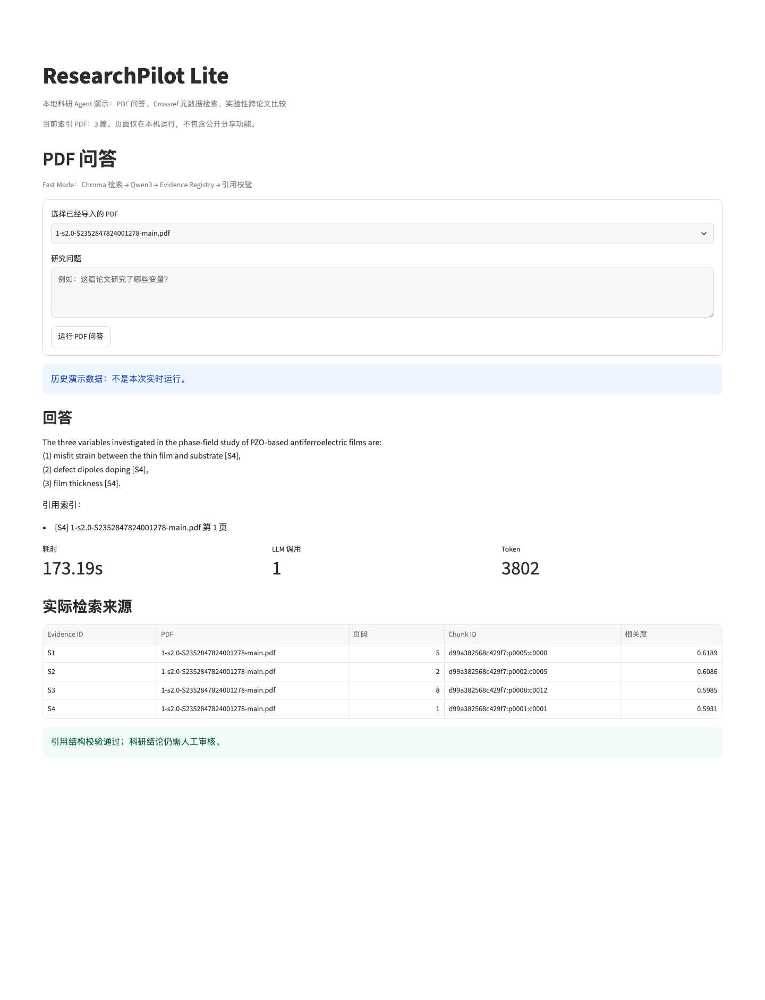
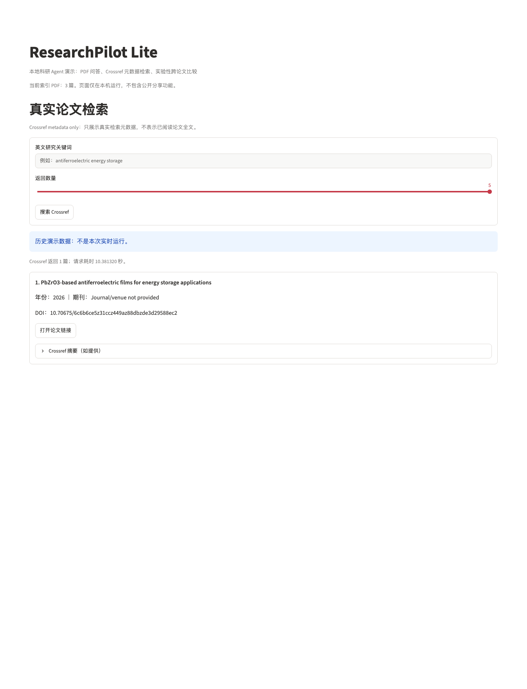
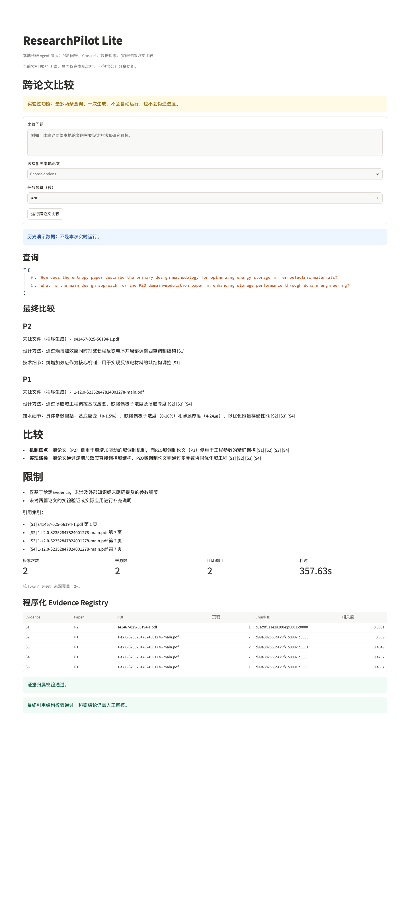

# ResearchPilot Lite 演示流程

本演示只使用本地 Ollama、用户已授权的 PDF 和公共 REST API。

## 启动前检查

```bash
source .venv/bin/activate
ollama list
python -m rag.cli status
```

至少确认：

- `qwen3:4b` 可用；
- `qwen3-embedding:0.6b` 可用；
- Chroma manifest 存在；
- Streamlit 可以从 `127.0.0.1` 访问。

启动：

```bash
streamlit run ui/app.py \
  --server.address 127.0.0.1 \
  --server.port 8501 \
  --browser.gatherUsageStats false
```

## 1. PDF 问答

历史演示预览：

```text
http://127.0.0.1:8501/?demo=pdf
```



### 可回答示例

选择一篇已经导入的论文，输入：

```text
Using only the imported local PDFs, which three variables are investigated
in the phase-field study of PZO-based antiferroelectric films?
```

预期：

- Fast Mode 调用本地 Chroma；
- Qwen 基于 Evidence 回答；
- 页面展示真实 PDF 文件名、页码和 `[S#]`；
- 在当前三篇测试 PDF 上，预期提取 misfit strain、defect dipoles doping
  和 film thickness；
- 实际耗时以页面本次结果为准。

### 证据不足示例

```text
根据当前已导入的本地 PDF，这些论文在 500 K 下测得的超导临界温度是多少？
```

预期：

- 没有足够相关的 Chunk；
- 页面显示“证据不足”；
- 不展示伪造 PDF 引用；
- 不调用回答模型。

## 2. 真实论文检索

历史演示预览：

```text
http://127.0.0.1:8501/?demo=paper
```



输入：

```text
antiferroelectric energy storage
```

预期：

- 调用 Crossref 公共 API；
- 展示本次返回的真实标题、年份、DOI 和链接；
- 缺失的期刊或摘要明确显示为未提供；
- 页面不表示已经阅读论文全文。

Crossref 返回项会随 API 状态变化。不要把本仓库中的历史 DOI 当成每次
运行的固定结果。

## 3. 跨论文比较

历史演示预览：

```text
http://127.0.0.1:8501/?demo=cross
```



这是实验性功能，不会自动运行。

1. 在 PDF 多选框中至少选择两篇本地论文；
2. 输入明确的比较问题；
3. 设置任务预算；
4. 点击“运行跨论文比较”；
5. 等待真实执行，不存在百分比进度。

建议示例：

```text
Using only the imported local PDFs, compare the main design approaches
of the entropy paper and the PZO domain-modulation paper.
```

预期：

- 最多两个子查询；
- 每路调用现有 Chroma Retriever；
- Evidence 按 `source_file + chunk_id` 去重；
- 参考文献列表型 Chunk 不进入最终 Evidence Registry；
- 最终每个 paper claim 绑定同源 `[S#]`；
- 来源文件名和页码由程序生成；
- 结果保持 `pending_human_review`。

当前本地实测约 6 分钟。页面会使用用户设置的超时预算，超时后显示真实错误。

## 历史结果说明

`evaluation/results/cross_paper_qa_20261110T095522Z.json` 是真实历史运行，
可在测试中用于验证页面渲染。它不得被重新标记为“本次实时运行”。

## 截图规范

截图放在 `docs/screenshots/`，文件名建议：

- `pdf-qa.png`
- `paper-search.png`
- `cross-paper.png`

只保存真正运行过的页面截图，不制作虚假结果。截图中不得出现：

- 绝对本地路径；
- API Key、Token 或邮箱；
- 未授权的私人文件；
- 用户不希望公开的完整论文内容。
